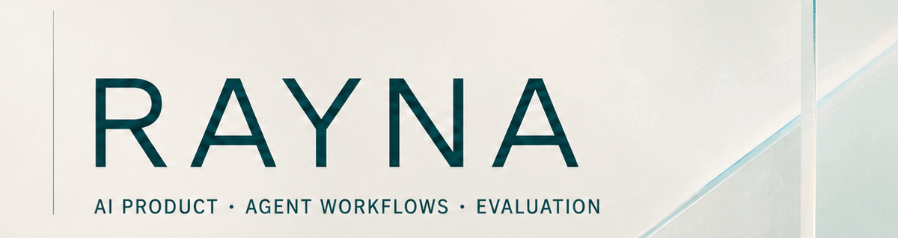

  

  
  
  
  
  
  

<strong>English</strong> · <a href="README.zh-CN.md">简体中文</a>

## About Me

I build AI product workflows for complex, unstructured inputs—turning documents and user feedback into traceable decisions through rules, models, code, and human review.

My current work focuses on AI agents for long-document workflows and output-quality governance. I care not only about whether a model can produce an answer, but whether the result can be traced to evidence, reviewed by a human, and safely rejected when its support is insufficient.

I completed my MSc in Artificial Intelligence and Digital Media at Hong Kong Baptist University in October 2026, with a background in data science.

## What I Work On

- **Agent and workflow products:** breaking complex tasks into controlled steps across models, rules, programs, and human decisions.
- **AI evaluation and quality loops:** evidence binding, badcase analysis, QA gates, human review, and reproducible run records.
- **Product delivery:** problem framing, workflow design, PRDs, prototypes, validation plans, and public demos with explicit boundaries.

## Industry Work

### AI product internship · bid-document agent

**Shenzhen Dowell Digital Technology Co., Ltd. (深圳笃威尔数字技术有限公司) · 2026.06–2026.09**

I worked on AI workflows for long, high-stakes bid documents. My contributions included decomposing rule/model/program responsibilities, designing evidence and review boundaries, investigating badcases, and governing long-document outline generation with traceable artifacts and quality gates. A high-risk clause detection workflow I helped iterate was integrated into the product's main process.

This is private industry work. No proprietary code, client documents, or internal datasets are published here.

## Featured Projects

### [Release Feedback Risk Workbench](https://github.com/Rayna-RRR/feedback-triage-agent)

**[Interactive Netlify demo](https://rayna-release-feedback-workbench.netlify.app/)** · [Repository](https://github.com/Rayna-RRR/feedback-triage-agent) · [Local setup](https://github.com/Rayna-RRR/feedback-triage-agent/blob/main/docs/usage.md) · Personal project

An evidence-first workflow for monitoring feedback in the 24–72 hours after a release. The static demo uses pre-generated acceptance fixtures to show the risk overview, issue clusters, original evidence, review previews, and follow-up window comparisons. Task creation and server-side CSV import are unavailable in the demo. Review previews are limited to the current page and clear on reload.

The full Python/FastAPI workbench runs locally and stores tasks as JSON files. The existing [Vercel preview](https://feedback-triage-agent.vercel.app/demo) uses temporary storage and may be unavailable in mainland China. The [PostgreSQL PR #14](https://github.com/Rayna-RRR/feedback-triage-agent/pull/14) remains unmerged, and the cloud database has yet to complete acceptance testing.

### [AI App Feedback Analysis](https://github.com/Rayna-RRR/ai-app-feedback-analysis)

A structured analysis of 30 public reviews across three AI apps, with 10+ annotation fields, a coding guide, QA checks, and product recommendations. It provides the labeling and quality baseline behind the feedback workbench; the small public sample is not treated as population-level evidence.

### [Agent Instruction Smells](https://github.com/Rayna-RRR/agent-instruction-smells)

A bilingual, copyable catalog of bad-to-fixed examples for `AGENTS.md`, `CLAUDE.md`, `SKILL.md`, and other coding-agent instruction files, covering conflicts, stale commands, context bloat, unsafe shortcuts, and review boundaries.

### [Agent Project Lab](https://github.com/Rayna-RRR/agent-project-lab)

A local-first CLI for turning rough project ideas into agent-ready briefs, repository rules, task prompts, reusable skills, and run logs. It focuses on clearer context and safer, repeatable AI-assisted development workflows.

## Paused Explorations

- **Solar Sync — paused:** an embodied interaction prototype exploring how mouse, keyboard, and optional camera signals can share one deterministic control loop.
- **情绪小怪物 — paused:** an early-stage emotional interaction concept; work stopped at problem discovery and MVP definition.

Both explorations are paused and remain unvalidated.

## Product & Technical Radar

| Layer | Current practice |
| --- | --- |
| Product | Problem framing, requirements, workflow design, PRDs, prototypes, validation plans |
| Agent workflows | LLM applications, structured outputs, tool orchestration, prompt and artifact contracts |
| Quality | Evidence binding, human-in-the-loop review, badcases, QA gates, evaluation harnesses |
| Build | Python, FastAPI, TypeScript, HTML/CSS, GitHub Actions, Codex |

## Education

- **MSc, Artificial Intelligence and Digital Media** — Hong Kong Baptist University, 2025.09–2026.10; official graduation date: 2026.10.31.

## Current Direction

Seeking full-time roles in the 2027 graduate recruitment cycle: **AI evaluation and application quality** (feedback analysis, badcase analysis, and regression validation), alongside **AI Product Management / Agent and Workflow products**. Shenzhen is my first choice; Shanghai and Hong Kong are also in scope.

## Contact

[Email](mailto:raynaren86@gmail.com) · [GitHub](https://github.com/Rayna-RRR) · [Workbench usage tutorial](https://github.com/Rayna-RRR/feedback-triage-agent/blob/main/docs/usage.md)
