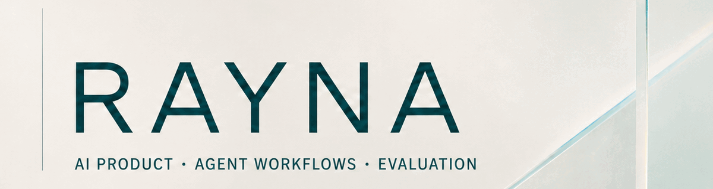

  

  
  
  
  
  
  

<a href="README.md">English</a> · <strong>简体中文</strong>

## 关于我

我主要关注如何把复杂、非结构化的业务输入拆成可控制的 AI 产品工作流，并通过规则、模型、程序与人工复核，将输出变成可追溯、可判断、可继续验证的产品结果。

目前的实践集中在长文档 Agent 与 AI 输出质量治理。我在意模型能否生成结果，也在意结论能否回到原始证据、能否由人工复核，以及证据不足时能否安全暴露失败。

已于 2026 年 10 月完成香港浸会大学人工智能与数字媒体理学硕士学业，具备数据科学背景。

## 我关注的方向

- Agent / Workflow 产品：将复杂任务拆为模型、规则、程序和人工判断共同参与的受控流程。
- AI 效果评测与质量闭环：证据绑定、badcase、QA 门禁、人工复核与可复现运行记录。
- 产品落地：问题定义、工作流设计、PRD、原型、验证方案，以及边界清晰的公开 Demo。

## 真实业务实践

### AI 产品实习 · 招投标智能体

**深圳笃威尔数字技术有限公司 · 2026.06–2026.09**

曾参与长文本、高风险招投标文档的 AI 工作流与输出质量治理，包括拆分规则、模型与程序职责，设计证据和复核边界，核查 badcase，并通过可追溯产物与质量门禁治理长文档大纲生成。其中参与迭代的高风险条款识别链路已合入产品主流程。

该部分属于企业内部项目；本主页不会公开公司代码、客户文档或内部数据。

## 精选项目

### [AI 发版反馈风险工作台](https://github.com/Rayna-RRR/feedback-triage-agent)

**[Netlify 静态交互演示](https://rayna-release-feedback-workbench.netlify.app/)** · [项目仓库](https://github.com/Rayna-RRR/feedback-triage-agent) · [本地使用教程](https://github.com/Rayna-RRR/feedback-triage-agent/blob/main/docs/usage.md) · 个人项目

面向产品发版后 24–72 小时的反馈风险发现、复核与回看。静态演示使用预生成的验收样例，可查看风险总览、问题簇和原始证据，预览人工复核，并比较后续窗口。任务创建和 CSV 导入表单仅供查看，复核结果仅在当前页面预览，刷新即清除。

完整 Python/FastAPI 工作台可在本地运行，任务保存在本机 JSON 文件中。原有 [Vercel 临时预览](https://feedback-triage-agent.vercel.app/demo) 使用临时存储，中国大陆网络环境可能无法访问。[PostgreSQL PR #14](https://github.com/Rayna-RRR/feedback-triage-agent/pull/14) 尚未合并，云端数据库尚未验收。

### [AI 应用用户反馈分析](https://github.com/Rayna-RRR/ai-app-feedback-analysis)

围绕三款 AI 应用的 30 条公开评论，设计 10+ 结构化字段，形成编码指南、QA 检查与产品建议，并为反馈工作台提供标签和质量基线。小规模公开样本不外推为整体用户结论。

### [Agent Instruction Smells](https://github.com/Rayna-RRR/agent-instruction-smells)

面向 `AGENTS.md`、`CLAUDE.md`、`SKILL.md` 等 Agent 规则文件的中英双语坏味道案例库，提供冲突、过期命令、上下文膨胀、不安全捷径等问题的 bad-to-fixed 示例。

### [Agent Project Lab](https://github.com/Rayna-RRR/agent-project-lab)

把粗略项目想法整理为 Agent 可执行的项目简报、仓库规则、任务提示词、可复用 Skill 与运行日志的本地 CLI，重点提升 AI 辅助开发中的上下文清晰度、边界与可复现性。

## 暂停探索

- **Solar Sync（已暂停）：**探索鼠标、键盘与可选摄像头信号如何进入同一确定性控制闭环的具身交互原型。
- **情绪小怪物（已暂停）：**停留在问题探索与 MVP 定义阶段的情绪交互概念。

两项探索均已暂停，尚未完成产品验证。

## 产品与技术雷达

| 层级 | 当前实践 |
| --- | --- |
| 产品 | 问题定义、需求分析、工作流设计、PRD、原型与验证方案 |
| Agent 工作流 | LLM 应用、结构化输出、工具编排、Prompt / Artifact 契约 |
| 质量治理 | 证据绑定、人工复核、badcase、QA 门禁与评测集 |
| 构建能力 | Python、FastAPI、TypeScript、HTML/CSS、GitHub Actions、Codex |

## 教育经历

- **香港浸会大学｜人工智能与数字媒体｜理学硕士**，2025.09–2026.10；正式毕业日期：2026.10.31。

## 当前方向

关注 2027 届正式岗位：**AI 效果评测与应用质量**（反馈分析、badcase 归因与回归验证），同时投递 **AI 产品经理 / Agent 与 Workflow 产品**方向。深圳优先，上海及香港可考虑。

## 联系方式

[邮箱](mailto:raynaren86@gmail.com) · [GitHub](https://github.com/Rayna-RRR) · [工作台使用教程](https://github.com/Rayna-RRR/feedback-triage-agent/blob/main/docs/usage.md)
